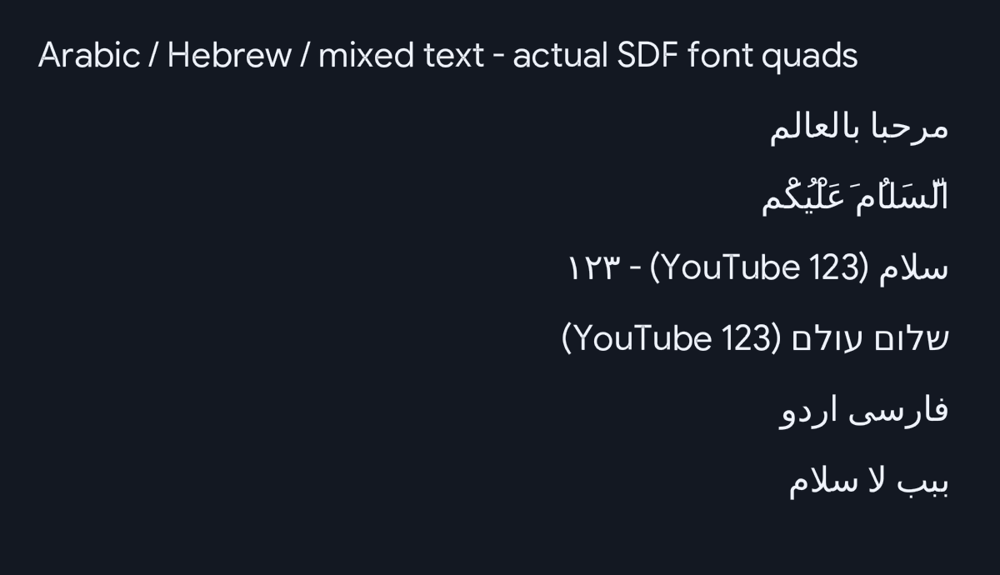

# Arabic and right-to-left text

The shared SDF text renderer supports Arabic joining and Unicode bidirectional
ordering. Video titles, channel names, comments and captions using
`gfx::Font` receive the same behavior. Hebrew and common Persian/Urdu letters
are included in the fallback atlas. English text, numbers and packed emoji can
appear inside an RTL line without reversing their internal order.

## Implementation

- Stored/API text remains logical UTF-8. `text_layout::visual` prepares each
  display line using the vendored FriBidi 1.0.16 library (Unicode 16.0).
- Arabic letters use contextual presentation forms, including lam-alef
  ligatures. Directional isolates/marks affect ordering and never draw as `?`.
- `dejavu-sans-rtl.huifont` is loaded once and shared by all four UI fonts in
  both the PS5 entry point and the host snapshot renderer. Its source is
  DejaVu Sans 2.37; rebuild with `make fonts`.
- Measurement and drawing use the same shaped visual text. Fit/wrap operate
  on logical input, preserve matched emoji sequences and trailing combining
  marks, and shape the resulting lines independently.
- Invalid UTF-8 is replaced before it reaches the bidi library.

The atlas adds about 1.7 MB before packaging. Library sources, Unicode tables,
font source, baked atlas and licenses are committed, so application builds do
not need a new network dependency or a system FriBidi installation.

## Scope

This is text rendering support, not an Arabic translation of the application
or a mirrored navigation/menu layout. Existing explicit left/center/right
alignment stays in effect; each displayed line uses its first strong character
to determine the bidi base direction. Wrapped lines resolve that direction
independently, rather than sharing paragraph embedding levels.

The baked font determines coverage: this does not promise every RTL script or
every Quranic annotation. Presentation-form shaping does not implement full
OpenType positioning, advanced mark stacking or language-specific typography.
Unmatched characters retain the existing `?` fallback. Display-unit clipping
preserves packed emoji and combining marks; it is not a complete Unicode
grapheme-break implementation.

## Verification

On the supported Linux/WSL toolchain:

```sh
make test
make lint
make
```

To run the focused regressions after building the unit-test binary:

```sh
build/tests/unit_tests --gtest_filter='Font.*:Emoji.*:TextLayout.*:RtlFont.*'
```

Examples to check on a PS5:

- `مرحبا بالعالم` and `السَّلَامُ عَلَيْكُمْ`
- `سلام (YouTube 123) - ١٢٣`
- `שלום עולם (YouTube 123)`
- Arabic alongside `👨‍👩‍👧`, `🇯🇵` and `👍🏽`
- Long titles that wrap or end in an ellipsis; verify captions at different sizes.

A host-rendered sample verifies font layout, not PS5 GPU output. Console
rendering and performance require a hardware check before calling a build
console-verified.

## Host rendering sample



This preview composites the actual font atlas/quads on the CPU; it is not a
PS5 screenshot.

## Validation for this change

- Ubuntu 24.04 / Clang 18: 339 unit tests and 14 integration tests passed.
- CI-style lint (`LINT_SKIP_TIDY=1 make lint`) passed.
- The 19 font, emoji and RTL regressions also passed on macOS with AddressSanitizer
  and UndefinedBehaviorSanitizer, including instrumentation of FriBidi.
- Both changed renderer translation units and all 10 vendored FriBidi C sources
  cross-compiled with the repository's PS5 target and payload SDK.
- The committed RTL atlas reproduced byte-for-byte with the Linux font baker.
- The clean-room runtime reproduced its pinned SHA-256 checksum.

The full application build stopped before compilation because the existing
pinned `ps5-opengl` 1.0.0 SDK download returned HTTP 404. No complete application
package or zero-static-FSELF-error result is claimed. Static analysis via
clang-tidy and PS5 hardware rendering/performance have not been verified.
